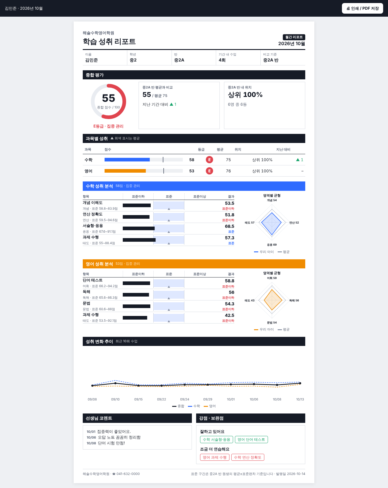
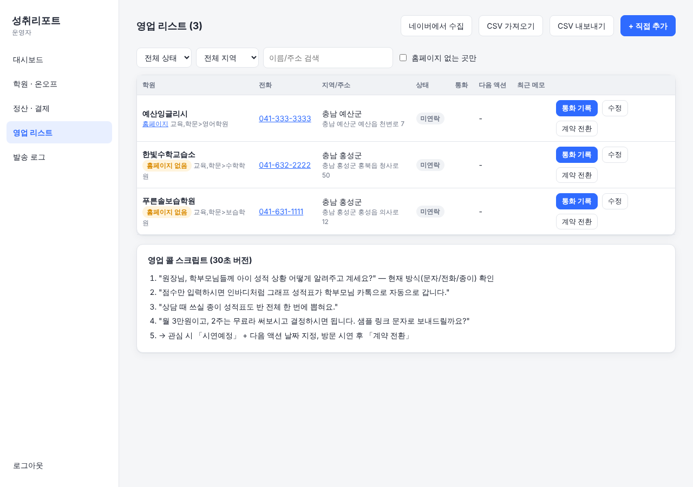
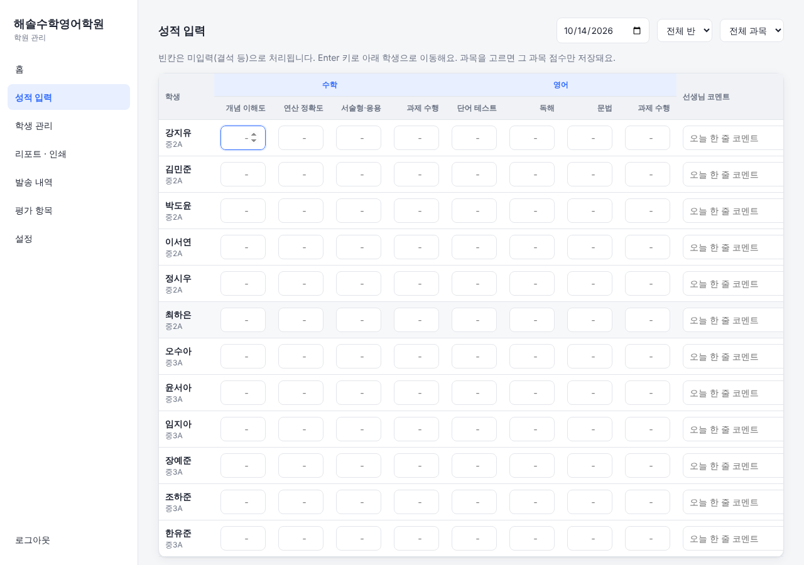

# withMJ · 성취리포트

> 소규모 학원용 **인바디식 온라인 성적표 + 카카오 알림톡 자동 발송** SaaS
> 월 3만원 · 군/시 단위 국소 지역 B2B 영업 모델 — "모두를 위한 서비스가 아니라, 우리 둘이 먹고 살 만큼"



## 무엇을 하나

| 누가 | 하는 일 |
|---|---|
| **선생님** | 수업 끝나고 반 단위 표에 점수 입력 → **완료** 클릭. 끝. |
| **시스템** | 매일 정해진 시각(기본 21시)에 주기(일간/주간/월간/분기)가 끝난 학생의 리포트 링크를 학부모 카톡으로 발송 |
| **학부모** | 카톡 버튼 → 휴대폰에서 인바디처럼 생긴 성적표 확인 (열람 여부도 기록됨) |
| **원장님** | 상담·게시용 종이 성적표를 반 전체 한 번에 A4 인쇄 (학생당 한 장 자동 맞춤) |
| **우리(운영자)** | 학원 계정 발급, 서비스 ON/OFF, 월 정산(카드 자동결제/계좌이체 확인), 미납 자동 정지, 영업 리스트 관리 |

### 성적표 구성 (인바디 벤치마킹)
- **과목 > 영역 > 항목** 3단 구조 (예: 수학 > 연산 > 연산 정확도). 학원마다 자유롭게 수정
- **종합 점수 링 + 등급(A~E)**, 반 평균 비교, 반 내 위치(상위 %), 지난 기간 대비 ▲▼
- **과목별 성취 표**: 과목마다 점수·등급·평균·위치·변화
- **과목별 상세**: 인바디처럼 `표준이하 | 표준 | 표준이상` 3칸 막대. 표준 구간은 같은 반 원생 평균±표준편차로 자동 계산 (항목별로 직접 지정도 가능)
- **영역별 균형 레이더**, **최근 10회 변화 추이**, 선생님 코멘트, 강점·보완점 자동 추출

## 실행

Node.js 22.5 이상만 있으면 됩니다 (DB는 Node 내장 SQLite, 별도 설치 없음).

```bash
npm install
cp .env.example .env      # 필요하면 수정
npm run seed              # 데모 학원/학생/8주치 기록 생성
npm start                 # http://localhost:3000
npm test                  # 핵심 로직 테스트
```

| 계정 | 이메일 / 비밀번호 |
|---|---|
| 운영자 | `admin@withmj.kr` / `change-me` (`.env`의 ADMIN_* 로 변경) |
| 데모 학원 | `demo@academy.kr` / `demo1234` |

`.env`의 `KAKAO_PROVIDER=mock` 상태에서는 실제 카톡 대신 서버 콘솔과 발송 내역에만 남습니다.

## 실서비스 전환 체크리스트

1. **카카오 알림톡**
   - 카카오 비즈니스 채널 개설 → 딜러사(현재 [솔라피](https://solapi.com) 어댑터 구현) 가입 → 채널 연결
   - 템플릿 검수 신청 (`src/services/kakao.js` 상단 주석의 문구 그대로), 버튼은 웹링크 `#{링크}`
   - `.env`: `KAKAO_PROVIDER=solapi`, `SOLAPI_*` 채우기. 알림톡 실패 시 문자로 대체 발송됨
   - 단가: 대략 건당 8~13원 → 학생 30명 × 주 1회 ≈ 월 1,200~1,600원. 3만원 중 원가 5% 수준
2. **결제** — 토스페이먼츠 자동결제(빌링)
   - 원장님이 카드 등록 → 발급된 `billingKey`를 운영자 화면 「학원 관리」에 입력
   - `.env`: `PAYMENT_PROVIDER=toss`, `TOSS_SECRET_KEY`
   - 카드 등록이 번거로운 학원은 계좌이체 → 「정산」에서 **입금 확인** 클릭
   - 규칙: 가입 후 14일 무료 → 매월 같은 날 청구 → 미납 7일 지나면 자동 정지 → 입금 확인 시 자동 재개
3. **배포**: 아무 VPS(월 5천~1만원)에 `npm start` + HTTPS(Caddy 등). `BASE_URL`을 실제 도메인으로. `data/withmj.db` 파일만 백업하면 됨

## 영업: 고객 찾기



1. 운영자 화면 「영업 리스트」→ **네이버에서 수집**: `시/군` + `읍·면·동` 목록 입력
   - 네이버 지역검색 API는 한 번에 5곳만 주므로 `동 × 학원종류(학원, 수학학원, 영어학원, 보습학원, 공부방, 교습소)`로 쪼개서 반복 검색, 중복 제거
   - [developers.naver.com](https://developers.naver.com)에서 검색 API 키 발급 → `.env`의 `NAVER_*`
   - 전화번호가 비어 오는 경우가 많아, 네이버 지도에서 직접 확인한 것을 **CSV 가져오기**로 넣는 것도 지원
2. **「홈페이지 없는 곳만」 필터** = 온라인 관리가 약한 곳 = 1순위
3. **통화 기록** 버튼으로 통화 내용·결과·다음 연락일을 쌓고, 다음 연락일이 지나면 빨갛게 표시
4. 계약하면 **계약 전환** → 학원 계정 자동 발급 (기본 평가 항목 포함, 2주 무료 시작)

화면 하단에 30초 콜 스크립트가 있습니다. 숫자 감: 200곳 × 3만원 = 월 600만원.

## 구조

```
src/
  server.js              서버 + 1분마다 발송 작업, 하루 한 번 정산
  db.js                  SQLite 스키마
  lib/time.js            한국시간 날짜 계산
  lib/auth.js            비밀번호 해시, 세션
  services/
    periods.js           일간/주간/월간/분기 기간 계산
    report.js            성적표 계산 (표준 구간, 과목 점수, 순위, 추이)
    dispatcher.js        자동 발송 (기간당 1회, 정지 학원 제외)
    kakao.js             알림톡 (mock / 솔라피)
    billing.js           청구·자동결제·미납정지 (mock / 토스)
    leads.js             네이버 수집, CSV
    defaults.js          신규 학원 기본 평가 항목
  routes/                auth · academy(학원) · admin(운영자) · public(학부모 링크)
public/
  academy.html / admin.html / report.html   화면 (빌드 없는 순수 JS)
  js/report.js           인바디식 차트(SVG) + 인쇄 자동 맞춤
test/core.test.js
```


